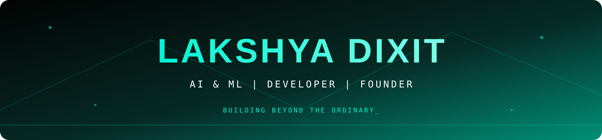

<div align="center">




<br/><br/>


<br/><br/>

<a href="https://github.com/FrigonF">

</a>

</div>

---

<h2 align="center">⌨️ SYSTEM INITIALIZED</h2>

```bash
┌──(LAKSHYA㉿DEV)-[~]
└─$ whoami

[+] Name       : Lakshya Dixit
[+] Education  : Computer Science
[+] Speciality : Artificial Intelligence & Machine Learning
[+] Role       : Developer / Founder
[+] Focus      : Building Real-World Products
[+] Status     : Currently Building SRIKA

┌──(LAKSHYA㉿DEV)-[~]
└─$ ./build_the_future.sh
```

<h2 align="center">◈ ABOUT ME</h2>

I'm **Lakshya Dixit**, a Computer Science student specializing in **Artificial Intelligence & Machine Learning**, developer, and founder who loves turning ambitious ideas into reality.

I'm passionate about building technology that pushes boundaries, experimenting with emerging technologies, and solving real-world problems through software.

I believe in learning by building, experimenting beyond conventional boundaries, and creating products that solve meaningful problems.

**My philosophy:** Don't just learn technology. Build something with it.

---

<h2 align="center">🚀 CURRENT OPERATIONS</h2>

<h3 align="center">01 // SRIKA</h3>

<div align="center">


<h3>AI-POWERED MOTION GAMING PLATFORM</h3>

</div>

Transforming human body movements into game controls through AI-powered motion recognition and human-computer interaction.

**Core areas:**
- Computer Vision
- Motion Recognition
- Human-Computer Interaction
- AI-powered Gaming

---

<h3 align="center">02 // KAIROS</h3>

<div align="center">


<h3>AI-DRIVEN ENVIRONMENTAL INTELLIGENCE</h3>

</div>

Working on intelligent oil spill detection and trajectory prediction to support environmental monitoring and analysis.

<div align="center">

<a href="https://github.com/FrigonF/Kairos">

</a>

</div>

---

<h3 align="center">03 // ACADIA</h3>

<div align="center">


<h3>BUILDING SMARTER DIGITAL EXPERIENCES</h3>

</div>

Exploring smarter digital systems and applications through software and technology.

<div align="center">

<a href="https://github.com/FrigonF/Acadia">

</a>

</div>

---

<h2 align="center">🧠 AREAS OF INTEREST</h2>

<div align="center">


</div>

---

<h2 align="center">⚙️ TECH ARSENAL</h2>

<div align="center">


</div>

---

<h2 align="center">🏆 ACHIEVEMENTS & RECOGNITION</h2>

<table>
<tr>
<td align="center" width="65">🥉</td>
<td>
<strong>3rd Prize — Google TechSprint / TeamSpirit Hackathon</strong><br/>
Recognition for hackathon performance.
</td>
</tr>

<tr>
<td align="center">🏅</td>
<td>
<strong>Selected — Smart India Hackathon (SIH)</strong><br/>
Selected for participation in the national innovation challenge.
</td>
</tr>

<tr>
<td align="center">🚀</td>
<td>
<strong>Top 10 — Smart BU</strong><br/>
Ranked among the top 10 out of 650+ participants.
</td>
</tr>

<tr>
<td align="center">🔬</td>
<td>
<strong>Research Contributor — Vigil AI</strong><br/>
Contributing to research-oriented AI work.
</td>
</tr>
</table>

---

<h2 align="center">📊 GITHUB STATISTICS</h2>

<div align="center">


<br/><br/>


</div>

---

<h2 align="center">🐍 CONTRIBUTION MATRIX</h2>

<div align="center">


</div>

---

<h2 align="center">🌐 CONNECT WITH ME</h2>

<div align="center">

<a href="https://github.com/FrigonF">

</a>

<br/><br/>

<strong>BUILDING TODAY WHAT I WISH EXISTED TOMORROW.</strong>

<br/><br/>

```text
[ SYSTEM MESSAGE ]

THE FUTURE IS BUILT, NOT PREDICTED.

01001100 01000001 01001011 01010011 01001000 01011001 01000001
```


</div>
